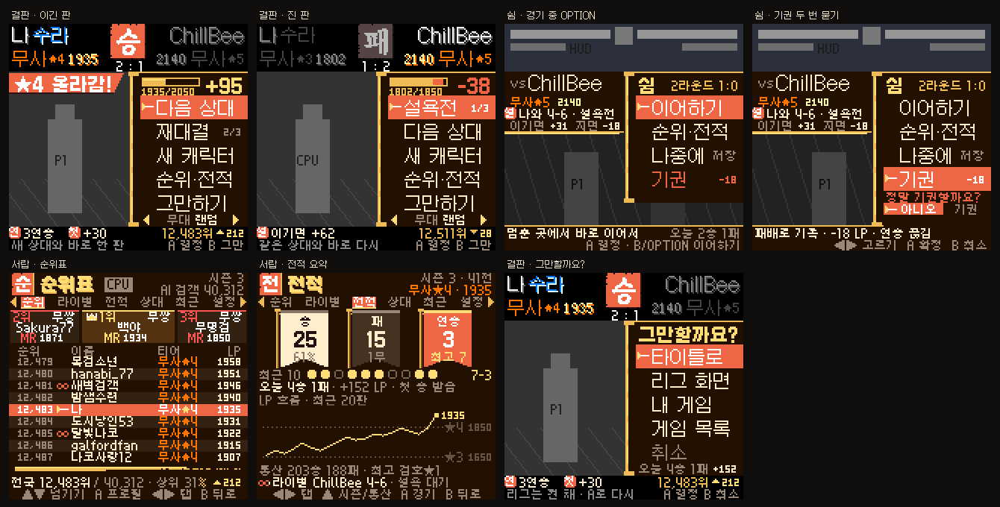
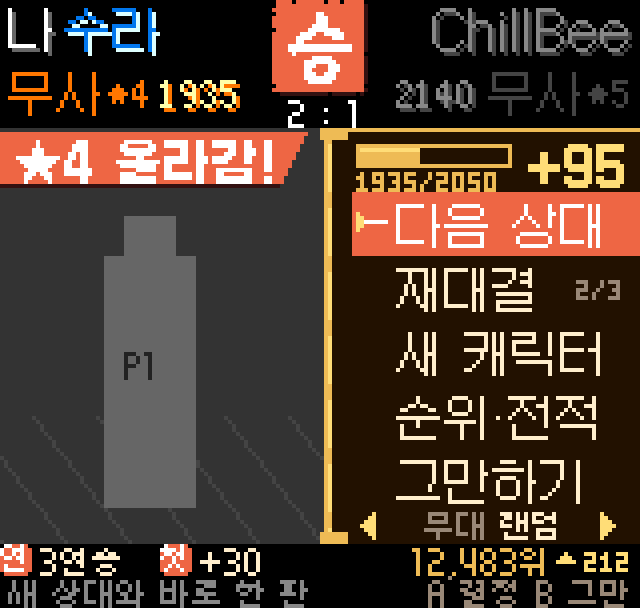
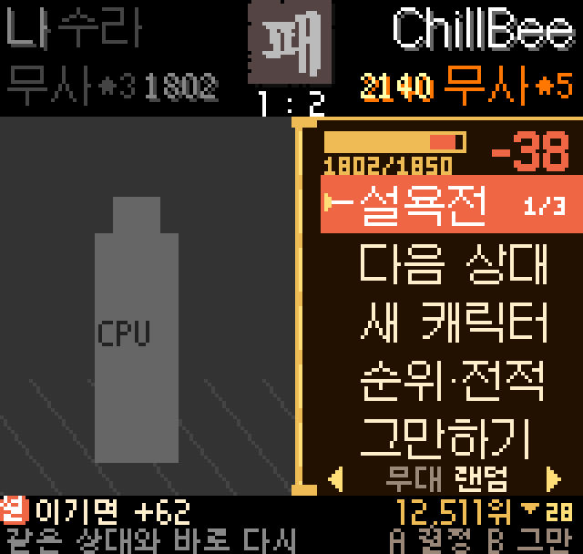
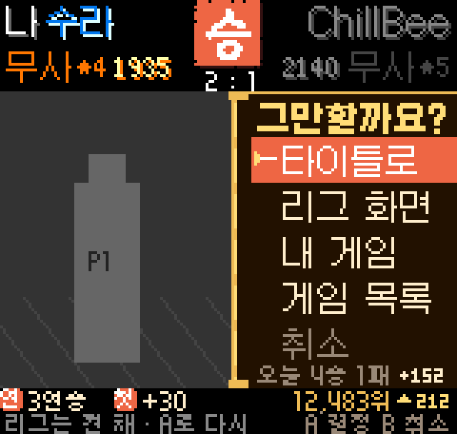
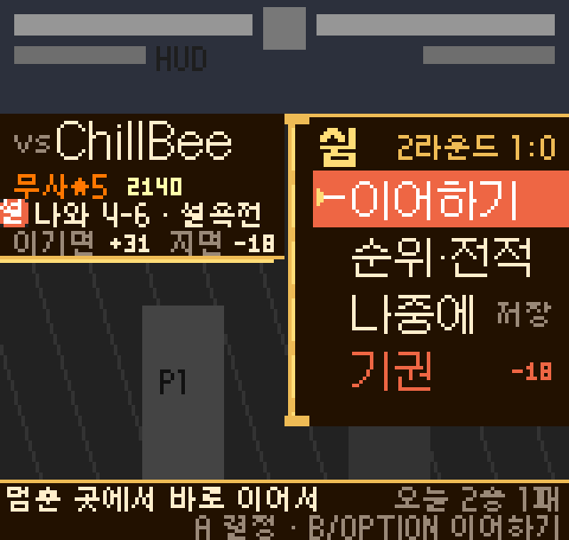
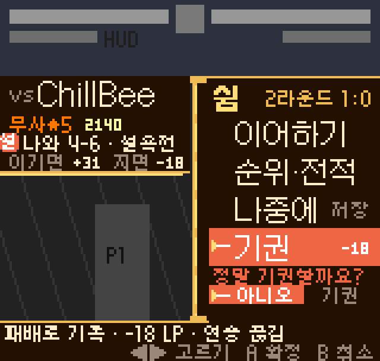
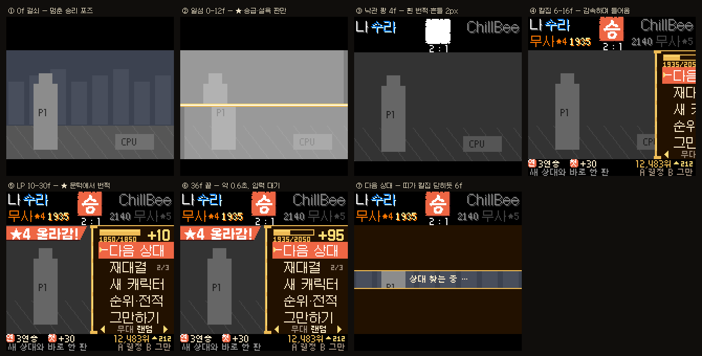
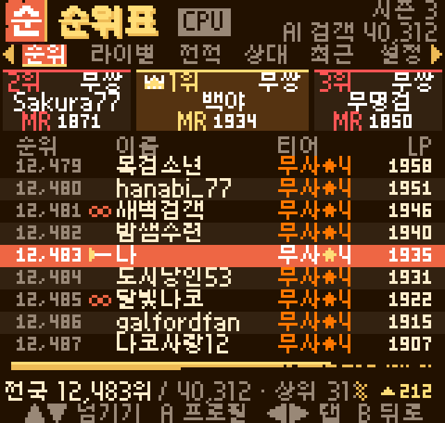
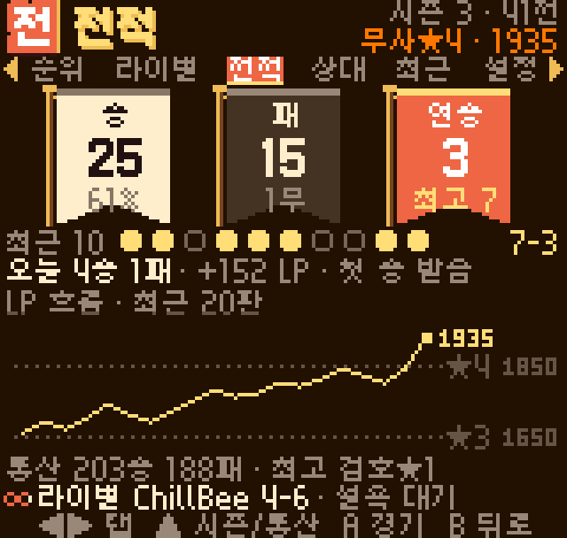
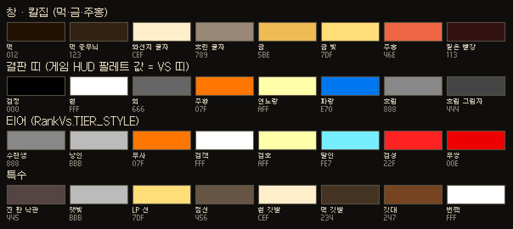

# 리그 대전 인게임 메뉴 기획서 — «칼집 메뉴» (157)

작성 2026-10-17 · 기준 코드 내부 156 (`feat/framegen-art` 4513cf0) · 이번 단계는 **기획만** 합니다(코드 변경 없음).

목업은 모두 우리 자산으로만 그렸습니다. 글꼴은 앱 픽셀 글꼴 Galmuri11(`pixel.ttf`·`pixel_b.ttf`)과 Galmuri7, 낙관 붓글자 하나에만 앱 `ink_b.ttf`(고운바탕, OFL)를 썼고, 나머지는 직접 찍은 픽셀 그림과 12비트 팔레트입니다. 게임 그림 자리는 회색 블록으로 비워 두었습니다. 롬·상태 파일·게임 화면 캡처는 한 장도 쓰지 않았습니다.

---

## 0. 목표 — 유저 요청 원문

> 오...그럴듯하네
> 리그 대전 들어가서 따로 인게임 메뉴를 만들어줘 간지나게
> 대전끝나고도 인게임메뉴로 그 대전지속할지 말지 중단할지 섲택라게허고
> 잉게임메뉴에서 순위표 등 볼수있게 전적이랑
> 기획부터

요청을 이렇게 읽었습니다.

1. **리그 전용 인게임 메뉴**: 앱 카드가 아니라 게임 화면 안에 들어가 있는 메뉴입니다. 156 VS 띠처럼 «게임 인터페이스 친화»로 만듭니다.
2. **대전이 끝나면** 그 메뉴에서 이어 갈지(다음 상대·재대결) 그만둘지를 고릅니다.
3. **순위표와 전적**도 게임 밖으로 나가지 않고 그 메뉴 안에서 봅니다.
4. **간지**: 사무라이 쇼다운다운 연출이 있어야 하고, 그러면서도 156의 «뚜뚜뚜 짧게»는 지킵니다.

---

## 1. 한 장 요약



| 부품 | 무엇인가 | 언제 보이나 |
|---|---|---|
| **결판 띠** | 위 검은 띠(160×32)에 결과를 적은 띠입니다. 칸 배치가 경기 전 VS 띠와 같고, VS 상자 자리에 붉은 낙관 «승·패·무»가 찍힙니다 | 경기 뒤 |
| **칼집** | 오른쪽 80px 옻칠 명령창입니다. Galmuri11, 줄 높이 16px라 폰에서 누르기 쉽습니다 | 결판 · 쉼 · 대기 |
| **서랍** | 화면 전체를 덮는 먹색 페이지입니다. 탭은 순위·라이벌·전적·상대·최근·설정입니다 | 칼집의 «순위·전적»에서 들어감 |
| **일섬** | 화면을 칼로 한 번 긋는 연출입니다. ★이 오르거나 승급·설욕했을 때만 나옵니다 | 사건이 있는 판의 결판 직전 |

핵심 결정 다섯 가지입니다.

1. **그리는 곳은 «덧판»**(native 가상 오버레이 판)입니다. 실측해 보니 경기 뒤 걸쇠(0x5825)에서는 VRAM에 그려도 화면 가운데에 나오지 않습니다. 덧판은 코어 메모리를 건드리지 않으니 저장 전 복원, 겹침 검사, 타일 예산을 신경 쓸 필요가 없습니다. 그리는 규칙은 NGPC와 똑같이 둡니다(8×8 칸, 칸마다 4색, 12비트 색).
2. **글자는 Java 한 곳에서** 그립니다. RankVs를 넓힌 TileCanvas가 맡습니다. native는 합성, 연출 대본 실행, 멈춤, 입력 막기만 합니다.
3. **결판은 지연 없이** 엽니다. 정산 순간에 장면을 미리 그려 «걸쇠에 맞춰 시작»으로 걸어 두고, 걸쇠가 서는 그 vsync에 native가 바로 엽니다.
4. **평범한 판은 약 0.6초** 안에 끝납니다. 일섬·호명 띠·승급 도장은 사건이 있을 때만 붙고, 어느 순간이든 A를 누르면 끝 장면으로 건너뜁니다.
5. **첫 묶음(157-A)만으로 요청 세 가지가 모두** 됩니다. 결판에서 이어 가기·그만두기, 쉼, 순위표 «내 주변», 전적 «요약»이 여기에 들어갑니다.

> 이 기획은 세 가지 시안(먹 족자 · 칼집과 두루마리 · 일섬 진막)을 비교한 결과입니다. 구조는 족자안, 명령창은 칼집안, 연출은 일섬안에서 가져와 합쳤습니다.

---

## 2. 언제 열리나

| 순간 | 여는 방법 | 코어 | 뜨는 것 | 지금(156) |
|---|---|---|---|---|
| **결판** (대전 끝) | 자동: 승리 대사가 끝나고 걸쇠가 서는 vsync | 걸쇠로 멈춤 | 결판 띠 + 칼집 | Java 결과 카드(rankResult) |
| **쉼** (경기 중) | OPTION을 짧게 누르기(다른 버튼과 함께 누르지 않을 때) · 안드로이드 뒤로 · 패드 바의 «목록/종료» | `ov_hold`로 멈춤 | 칼집 + 판 정보 패 | 게임 자체 PAUSE / Ask 카드(leagueLeave) |
| **대기** (리그 타이틀) | «리그 대전» 줄에서 찾기 전에 OPTION 또는 뒤로 | `ov_hold`로 멈춤 | 칼집 | hubLeave Ask 카드 |
| **서랍** | 위 세 칼집의 «순위·전적», 결판에서는 OPTION도 | 부른 쪽 그대로 | 전체 화면 페이지 | LeagueActivity(게임을 내려야 볼 수 있음) |

이럴 때는 **열지 않습니다**.
- 승리 대사 중: B로 대사를 건너뛰는 지금 동작을 그대로 둡니다.
- 찾기 판과 4배속 자동 고르기 중: 156 규칙(B = 그만)을 따릅니다.
- 연습·일반 세션: 연습 OPTION 메뉴와 게임 PAUSE를 그대로 둡니다.

첫 라운드 전에 쉼을 열면 «기권» 자리에 «그만두기 (무효 · LP 없음)»이 옵니다.

---

## 3. 메뉴 구조

```
리그 칼집 메뉴 (랭크 판의 저장·로드·리셋·설정 막힘은 그대로)
│
├─ [결판] 경기 뒤 자동 ─ 기본 커서: 이긴 판·무승부 = 다음 상대 / 진 판 = 설욕전
│   ├─ ▶ 다음 상대 ............ rankNext(false) → 156 찾기 판 → 4배속 → VS 띠 → 대전
│   ├─   재대결 n/3 (진 판엔 «설욕전 n/3») ... rankRematch — ◀▶로 고른 무대를 쓰게 고침(G9)
│   │      · 3판을 다 했거나 지원하지 않는 조합이면 흐리게 하고, 아래 띠에 이유
│   ├─   새 캐릭터 ............ rankNext(true) — 다음 판만 직접 고르고 새로 저장(rankAuto==2일 때만)
│   ├─   순위·전적 › .......... 서랍 (OPTION도 같음)
│   ├─   그만하기 › ........... [그만할까요?]
│   │      ├─ ▶ 타이틀로 ....... hubReturn(-1) — 리그는 켜 둔 채, A로 다시 찾기
│   │      ├─   리그 화면 ...... leagueExitBoard
│   │      ├─   내 게임 ........ hubToGame
│   │      ├─   게임 목록 ...... goList
│   │      └─   취소 (B)
│   └─ ◀▶ 무대: 상대 기본 → 랜덤 → 8곳 ... pref.stage (커서가 어디 있든 늘 무대)
│   * 보류·무효 경기: 낙관 «무효», «다음 상대 · 그만하기»만
│
├─ [쉼] 랭크 경기 중 OPTION 짧게 · 뒤로
│   ├─ ▶ 이어하기 (B·OPTION도 같음)
│   ├─   순위·전적 ›
│   ├─   나중에 [저장] ......... leagueLeave의 «나중에 이어하기»(체크포인트 → 리그 화면)
│   └─   기권 −n LP ........... 두 번 묻기(▶아니오 / 기권) → League.forfeit → 결판(기권패)
│
├─ [대기] 리그 타이틀 OPTION (157-B)
│   ├─ ▶ 상대 찾기 (= A) · 순위·전적 › · 내 캐릭터 ◀하오마루·수라▶ (A = 바꾸기)
│   └─   리그 나가기 › 내 게임 / 리그 화면 / 게임 목록 / 취소
│
└─ [서랍] ◀▶ 탭 · ▲▼ 넘기기 · A 자세히 · B 부른 칼집으로 · OPTION 닫기
    ├─ 순위   : 위 3명 단상 + 내 주변(내 줄을 가운데 고정) → 위로 넘기면 전국 100위까지 이어짐
    │            └ A → 프로필 패 (칭호·지역·주캐·나와 전적·최근 5·한마디 · «도장 고스트 · 실제 사람 아님»)
    ├─ 라이벌 : 12명 + 3판 넘게 붙은 상대 · 나와 승-패 · 꼬리표(설욕전·천적·연승 끊은 상대)
    ├─ 전적   : 요약(깃발 셋 · 최근 10 · 오늘 · LP 흐름 · 통산) — ▲ = 이번 시즌 ↔ 통산
    ├─ 상대   : 상대 캐릭터 5×3 격자(이름 글자 + 승-패 + 승률 막대) → A = 그 캐릭터와 한 경기 목록
    ├─ 최근   : 최근 20경기 → A = 경기 한 장(지금 결과 카드 내용을 타일로)
    └─ 설정   : 결판 연출(보통/짧게/끄기=옛 카드) · 진 판 기본 커서 · 연속 대전(끔/10초) · 메뉴 소리
```

---

## 4. 화면별 설계 (160×152 = 20칸 × 19줄, 1칸 = 8×8)

표기: `c` = 칸(0–19), `r` = 줄(0–18).

### 4.1 결판 — 이긴 판

 (원본 160×152: `p1_result_win_1x.png`)

| 자리 | 내용 |
|---|---|
| r0–1 | 왼쪽: «나 수라»(흰색·파랑, VS 띠와 같은 자리·같은 HUD 팔레트). 가운데 c8–11: 낙관 24×24. 오른쪽: 상대 닉(진 쪽은 회색으로 끔) |
| r2–3 | 왼쪽: 티어★ + LP(그 자리에서 숫자가 오름). 가운데: «2 : 1». 오른쪽: LP + 티어★. VS 띠와 같은 4×7 숫자를 씁니다 |
| c0–9 × r4–16 | 멈춘 무대와 이긴 포즈입니다(니블 3/4로 살짝 어둡게). 사건이 있으면 r4–5에 호명 띠 «★4 올라감!» |
| c10–19 × r4–5 | 칼집 머리: LP 막대, «1935/2050»(지금 / 다음 ★), «+95» |
| c10–19 × r6–15 | 명령 5줄 × 16px: ▶다음 상대 / 재대결 2/3 / 새 캐릭터 / 순위·전적 / 그만하기 |
| r16 | ◀ 무대 랜덤 ▶ |
| r17 | 꼬리표 도장 [연]3연승 [첫]+30 … 오른쪽에 «12,483위 ▲212»(이번 판 전후) |
| r18 | 고른 줄 설명 «새 상대와 바로 한 판» · «A 결정 B 그만» |

**조작**
- ▲▼: 줄을 옮깁니다. 위아래 끝에서 돌아가고, 꾹 누르면 18프레임 뒤부터 5프레임마다 넘어갑니다(연습 메뉴와 같음). 쓸 수 없는 줄은 건너뜁니다.
- ◀▶: 언제나 무대를 바꿉니다.
- A: 결정합니다.
- B: 처음 누르면 커서만 «그만하기»로 갑니다. 그 위에서 한 번 더 누르면 그만할까요? 창이 열립니다.
- OPTION: 서랍(순위표)으로 바로 갑니다.
- 안드로이드 뒤로 = B.
- 터치: 줄을 탭하면 커서가 가고, 같은 줄을 다시 탭하면 결정합니다. 무대 줄은 왼쪽·오른쪽 절반이 ◀▶입니다.

**실수 막기**
- 창이 열릴 때 쥐고 있던 키(대사를 넘기던 B·A 연타)는 손을 뗄 때까지 무시합니다.
- 칼집이 자리 잡기 전(16f 전)에 누른 A는 연출만 건너뛰고, 고르지는 않습니다.

### 4.2 결판 — 진 판과 그 밖의 결과



| 결과 | 띠 낙관 | 칼집 머리 | 기본 커서 · 아래 띠 |
|---|---|---|---|
| 진 판 | 먹 «패», 내 쪽 글자 회색 | 막대의 잃은 몫을 붉은 꼬리로 20f 남겼다가 줄임 · «−38» | **설욕전 1/3** · [설] 이기면 +62 |
| 무승부 | 금 «무» | 막대 그대로 | 다음 상대 |
| 기권 | 먹 «기권» | 진 판과 같음 | 다음 상대 · 멈춘 대전 화면 위에서 열림 |
| 배치 경기 | 승/패 | 막대 대신 ●●●○○ «배치 3/5» | — |
| 무쌍 | 승/패 | 막대 없이 «MR 1532 +12» | — |
| 강등 위기 / 강등 | 패 | 막대 테두리가 주홍으로 깜빡임 · «위» 도장 / «검객 → 무사» 잿빛 | — |
| 수련생이 짐 | 패 | «LP 그대로 · 수련생 보호» | — |
| 보류·무효 | «무효» | 연출 없음 | 다음 상대 · 그만하기만 |

> 1단계에서는 칼집을 늘 오른쪽에 둡니다. 이긴 캐릭터가 오른쪽에 서 있으면 칼집이 포즈를 가릴 수 있어서, 캐릭터 위치(RAM)를 실측한 뒤 2단계에서 진 쪽에 거울로 여는 안을 검토합니다(질문 2).

### 4.3 그만할까요?



결판 띠와 아래 띠는 그대로 두고, 칼집 안의 목록만 «칼 휘두름»(사선 와이프 6f)으로 바뀝니다. 목록은 ▶타이틀로(기본) / 리그 화면 / 내 게임 / 게임 목록 / 취소입니다. r16에는 이번 대전 세션 요약 «오늘 4승 1패 +152»를, r18에는 고른 줄 설명 «리그는 켠 채 · A로 다시»를 둡니다. B나 «취소»를 누르면 결판으로 돌아가고 커서는 «그만하기»에 둡니다.

### 4.4 쉼 — 경기 중

 

- **HUD(0–31줄)는 가리지 않습니다.** 체력과 시간을 보며 판단할 수 있게 하려는 것이고, 어둡게 하는 것은 무대 줄(니블 2/4)뿐입니다. 체크 디더는 업스케일러와 만나면 물결무늬가 생겨서 쓰지 않습니다.
- 칼집 위치는 결판과 같아서 손 위치가 늘 같습니다.
  - 머리: «쉼 · 2라운드 1:0».
  - 명령: ▶이어하기 / 순위·전적 / 나중에 [저장] / 기권 −18.
- 왼쪽 위 판 정보 패에는 «vs ChillBee», «무사★5 2140», «[설] 나와 4-6 · 설욕전», «이기면 +31 · 지면 −18»(RankCore.stakes)을 둡니다.
- 아래 먹 띠: r17에 고른 줄 설명과 «오늘 2승 1패», r18에 «A 결정 · B/OPTION 이어하기».
- **기권은 두 번 묻습니다.**
  1. A를 누르면 기권 줄이 주홍으로 맥박치고, 그 아래에 «정말 기권할까요?»와 [▶아니오 | 기권]이 펼쳐집니다. 기본은 아니오이고 ◀▶로 고릅니다.
  2. 아래 띠에 결과 미리보기 «패배로 기록 · −18 LP · 연승 끊김»을 보여 줍니다. 배치 중이면 «배치 1패», 수련생이면 «LP 그대로»로 바뀝니다.
  3. 확정하면 League.forfeit을 부르고, 같은 칼집이 결판(기권패)으로 바뀝니다.
- 닫을 때는 쥐고 있던 키를 뗄 때까지 게임에 주지 않습니다(qHeld 방식). 다시 돌자마자 A가 공격으로 새지 않게 하려는 것입니다.
- 칼집 밖을 탭하면 이어하기입니다(기권은 늘 두 단계).

### 4.5 대기 — 리그 타이틀 (157-B)

쉼과 같은 칼집을 씁니다. 머리에는 «리그 · 무사★4 1935 LP»와 «오늘 4승 1패 · 첫 승 보너스 +30 남음»(rankedToday·bonusLeft, 153 이후 쓰이지 않던 함수)을 둡니다. 명령은 ▶상대 찾기 / 순위·전적 / 내 캐릭터 ◀▶ / 리그 나가기 ›입니다. r16에는 오늘의 팁 한 줄(RankTips.next())을 둡니다. B나 OPTION을 누르면 닫힙니다.

### 4.6 서랍 공통

- 화면 전체를 쓰고, 바탕 처리는 «먹 채움(012)»입니다.
- r0–1 머리: 16px 낙관 + 제목(Galmuri11 Bold, 그림자) + [CPU] 칩 + 오른쪽에 시즌·총원.
- r2 탭: 지금 탭은 주홍 칩, 나머지는 흐린 글자이고 양끝에 ◀▶.
- 마지막에 본 탭은 League pref에 기억해 둡니다.
- 움직임
  - 들어갈 때: «족자 펼침». 위 축이 2줄/프레임으로 내려옵니다(10f).
  - 탭을 바꿀 때: «칼 휘두름». 사선 띠가 2칸/프레임으로 쓸고 지나갑니다(10f).
  - 넘길 때: 목록 층의 y 오프셋을 2px/프레임으로 옮겨 부드럽게 넘깁니다.
- 순위표와 전적의 자세한 설계는 §6, §7에 있습니다.

---

## 5. 대전 끝 흐름 (KO → 대사 → 결과 → 메뉴)

```
결판 프레임 ── 지금처럼 바로 정산(153). 화면에는 아무것도 안 띄움
   │  Java(백그라운드): MenuModel 사본 → TileCanvas로 결판 장면(타일·맵·팔레트) + 연출 대본(cue)
   │  → nativeOvCue(..., ARM_ON_LATCH) · BoardCache 미리 데우기 시작
   ▼  (KO·승리 대사 ≈ 9~10초 — B로 건너뛰기는 그대로)
걸쇠(0x5825)가 서는 vsync ── native가 Java를 기다리지 않고 대본 시작
   ▼
연출 (아래 표) ── A = 끝 장면으로 건너뜀(고르지는 않음)
   ▼
입력 대기 ── 자동으로 넘어가지 않음(설정 «연속 대전 10초»를 켰을 때만)
   ├─ 다음 상대 / 재대결 → 칼집이 오른쪽으로 빠지고 위아래 검은 띠가 칼집 닫히듯 6f에 붙음
   │                      → 틈에 «상대 찾는 중 …» → 156 찾기 판 → 4배속 자동 → VS 띠 → 1회전
   ├─ 새 캐릭터 → 같은 흐름, 고르기 화면만 직접
   └─ 그만하기 → 그만할까요? → 타이틀로 / 리그 화면 / 내 게임 / 게임 목록
```



**연출 박자 (60Hz 시계, 120Hz 화면도 같은 박자)**

| 프레임 | 보통(기본) — 평범한 판 |
|---|---|
| 0 | 걸쇠 프레임 그대로 |
| 0–3 | «먹 번짐»: 무대를 니블 4/4 → 3/4로 |
| 2–7 | 띠의 두 이름이 양옆에서 8px/f로 미끄러져 들어옴 |
| 4–5 | «낙관 쾅»: 낙관 팔레트를 흰색으로 2f, 화면 2px 흔들림 4f, 진 쪽 글자를 회색으로 |
| 6–16 | 칼집이 오른쪽에서 들어옴(줄 x 오프셋 72→0으로 감속). 16f부터 새로 누른 키를 받음 |
| 10–30 | LP 숫자가 틱틱 오르고 막대가 2px/f로 참. ★ 문턱을 넘으면 금↔흰으로 3번 번쩍 |
| 18–26 | 아래 띠 도장이 4f 간격으로 찍힘 |
| **≈36** | **끝(약 0.6초)** |

| 덧붙는 것 | 언제 | 길이 |
|---|---|---|
| **일섬**: y84에 흰·금 칼선(40px/f) → 흰 번쩍 55% → 위아래 ±4px 베임 → 원래대로 | ★이 오르거나 승급·설욕한 판(설정 «보통»일 때. «짧게»에서는 안 나옴) | +12f |
| **호명 띠**: 최대 2개. 우선순위는 승급·강등 > 설욕·라이벌 > 3연승 이상 > 오늘 첫 승 > 연승 끊음 > 배치 완료. 나머지는 아래 띠 도장으로 | 사건이 있을 때 | 각 24f |
| **승급 문장**: 가운데 32×32 티어 문장 + «승급! 검객» 쾅 | 티어가 오를 때 | +36f |
| «짧게» 설정 | 낙관 + 칼집만 | ≈18f(0.3초) |
| «끄기» 설정 | 지금 Java 결과 카드(대체 길) | — |

결과적으로 평범한 판은 0.6초, ★ 판은 약 1.0초, 승급 판은 약 1.6초입니다. 어느 경우든 A 한 번이면 끝 장면입니다.

---

## 6. 순위표 설계



**보여 주는 것** («순위» 탭, 기본)
- r3–5 단상 셋: 2위(왼쪽), 1위(가운데, 금 + 왕관), 3위(오른쪽). 무쌍은 MR로 줄 세웁니다(RankCore key).
- r6 열 머리: 순위 / 이름 / 티어 / LP.
- r7–15 목록 9줄: 내 줄을 r11에 고정한 «내 주변 ±4»입니다. 줄무늬 줄을 쓰고, 라이벌은 주홍 사슬, 내 줄은 주홍 막대에 단도 커서를 둡니다.
  - 열 배치: 순위(3×5 숫자, 오른쪽 맞춤) · 아이콘 c4 · 닉 최대 7자(넘치면 «…») · 티어(티어 색) · LP(무쌍은 MR).
  - ▲▼로 계속 넘기면 위로는 **전국 100위까지 끊기지 않고** 이어집니다. 꾹 누르면 빨라집니다.
- r17: «전국 12,483위 / 40,312 · 상위 31% ▲212». ▲▼는 오늘 첫 판 전과 비교한 값입니다.
- 가상 상대라는 표시는 늘 둡니다: 제목 옆 [CPU] 칩, «AI 검객 40,312», 프로필 패의 «도장 고스트 · 실제 사람 아님». 상대 카드에서 대전을 신청하는 기능은 넣지 않습니다(상대는 늘 rankedPick이 고름).

**어떻게 세나**

| 값 | 출처 | 비고 |
|---|---|---|
| 위 3명 · 위 100명 | `RankCore.top(seed, day, n, book, myKey, myNick)` | 한국 자정마다 흔들림 ±45 |
| 내 주변 ±k | `RankCore.around(k)` | |
| 전국 n위 / 총원 · 상위 % | `rankOf` · `total()` | 위 150 안이면 정확, 밖이면 분포로 어림 |
| 라이벌 · 꼬리표 | `ranked.players` · `League.h2h` · `RankCore.tag` | |
| 이번 판 ▲▼(결판) | **새 칸** `match.rank_before/after`: 정산 뒤 백그라운드에서 rankOf로 어림 | G1 |
| 오늘 ▲▼(서랍) | **새 칸** `ranked.session.rank0`: 오늘 첫 판 전 순위 | G2 |

**비용**: top과 rankOf, 프로필·아바타 생성은 무겁습니다(에뮬레이터에서 UI 스레드가 수십 초 멈춘 기록이 있음).
- LeagueActivity에 있던 boardKey 캐시와 백그라운드 계산을 **BoardCache**로 빼내 리그 화면과 게임 안에서 같이 씁니다(G12).
- 결판 프레임에서 미리 데웁니다.
- 아직 덜 됐으면 줄 자리에 금빛이 일렁이는 «먹 가는 중…» 막대를 띄웁니다.

**프로필 패** (줄에서 A): 닉 · [CPU] · 티어★ · LP · 순위 · 칭호 · 지역 · 성향 · 주캐·유파 · 나와 승-패 · 최근 맞대결 ○● 5개 · 꼬리표 · 한마디(ProfileGen). 아바타(24×24, 여러 색)는 칸마다 3색 규칙과 맞지 않아 157-C의 선택 항목으로 둡니다.

---

## 7. 전적 설계



**«전적» 탭 = 요약** (▲ = 이번 시즌 ↔ 통산)

| 자리 | 내용 | 출처 |
|---|---|---|
| r3–7 | 노보리 깃발 셋: 흰 «승 25 · 61%» / 먹 «패 15 · 1무» / 주홍 «연승 3 · 최고 7» | `ranked.w/l/d/streak/best` |
| r8 | 최근 10: 금빛 찬 알 = 승, 흐린 빈 알 = 패 · «7-3» | `rankedHistory(10)` |
| r9 | 오늘 4승 1패 · +152 LP · 첫 승 받음 | `rankedToday()` · `bonusLeft()` |
| r10–15 | LP 흐름 20판: 금 꺾은선 + ★ 경계 점선(★4 1850 / ★3 1650) + 지금 값 | `lp_before/after` |
| r16 | 통산 203승 188패 · 최고 검호★1 | `careerWLD()` · `seasons()` |
| r17 | ⛓ 라이벌 ChillBee 4-6 · 설욕 대기 | `h2h` · `tag` |

**다른 탭**
- **상대**: 상대 캐릭터 15명을 5×3 격자로 보여 줍니다. 한 칸은 4칸×4줄이고, 이름 2자(«나코»)와 승-패, 승률 막대(50%를 넘으면 금색)를 넣습니다. 게임 얼굴 그림은 쓰지 않습니다. A를 누르면 그 캐릭터와 붙은 경기 목록이 나옵니다. 위쪽에는 내 캐릭터×유파 승패를 둡니다(`result.my_char/my_style`).
- **최근**: 최근 20줄을 «●승 2:1 +95 ChillBee 나코루루»처럼 보여 줍니다. A를 누르면 «경기 한 장»이 열립니다(점수 · LP 전→후 · 보너스 내역 · 사건 · 경기 시간 (frame − start_frame)/60 · 상대 한마디).
- **시즌**(설정 옆): 시즌 줄은 보기만 합니다. 허브가 켜져 있는 동안 새 시즌·처음부터는 막혀 있습니다(resetBlockedWhy).

**새로 저장할 자료** (league.json 선택 칸이라 옛 파일과 호환되고, H와는 상관없음)

| 칸 | 쓰는 곳 | 빈칸 |
|---|---|---|
| `ranked.session {start, w, l, d, lp, rank0}`: 허브를 켤 때 새로 만듦 | 그만할까요? · 쉼 · 순위 ▲▼ | G2 |
| `match.rank_before / rank_after` | 결판 ▲▼ | G1 |
| `match.my_main`: 시작할 때 사본 | 기권 경기의 내 캐릭터 | G3 |
| `match.season` | 시즌별 전적 | G6 |
| 재대결 무대 = `pref.stage` | 고침 | G9 |
| 기권 미리보기(askForfeit 계산을 옮겨 옴) | 쉼 | G10 |

---

## 8. 「간지」 스타일 가이드

**모티프**

| 모티프 | 어디에 |
|---|---|
| 낙관(인장) | 결판 «승·패·무·기권» 24px, 꼬리표 8px «연·설·첫·위·라», 서랍 제목 16px |
| 칼집 | 명령창: 옻칠 몸통, 왼쪽 금 테, 위아래 금 마개 |
| 단도 커서 | 고른 줄의 ▶ 자리. 16f마다 1px씩 까딱 |
| 붓 한 획 | 구분선. 머리는 굵고 꼬리는 마른 붓 |
| 족자 축 | 서랍이 펼쳐지는 동작 |
| 노보리 깃발 | 전적 요약 |
| 일섬 | 사건 판의 칼선 |

**색** — 새 색은 만들지 않고 세 묶음만 씁니다.



| 묶음 | 값(0x0BGR) | 규칙 |
|---|---|---|
| 우리 창(먹·금·주홍) | 먹 012 · 줄무늬 123 · 글자 CEF · 흐린 글자 789 · 금 5BE · 금빛 7DF · 주홍 46E · 짙은 빨강 113 | 앱 Theme 먹·금을 12비트로 옮긴 것. 고른 줄 = 흰 글자 / 금 단도 / 주홍 막대 |
| 결판 띠 | 게임 HUD 팔레트 값(FFF/666, AFF/07F, FFD/E70, 888/444, 000) | 156 VS 띠와 같은 값이라 경기 전과 뒤가 짝을 이룸 |
| 티어 | RankVs.TIER_STYLE과 같은 빛깔(무사 07F 등) | 띠·서랍·프로필 어디서나 같은 색 |

**글꼴**

| 쓰임 | 글꼴 |
|---|---|
| 명령 줄·제목·띠 이름 | Galmuri11 12px(앱 `pixel.ttf`), 줄 높이 16px |
| 강조(+95, 제목, 깃발 숫자) | Galmuri11 Bold(`pixel_b.ttf`) |
| 서랍 목록·보조 줄·아래 띠 | Galmuri7 8px. 한 줄 = 8px, 한 줄에 19–20자. 새 자산 |
| 작은 숫자 | 우리 4×7(VS 띠와 같음)·3×5 |
| 낙관 붓글자 | 고운바탕 Bold(앱 `ink_b.ttf`)를 빌드 때 1비트 그림으로 구움 |

**전환 이름표**

| 이름 | 쓰는 곳 | 길이 |
|---|---|---|
| 먹 번짐 | 결판·쉼을 열 때 바탕을 어둡게 | 2–4f |
| 낙관 쾅 | 결판 낙관 · 승급 문장 | 2f 번쩍 + 4f 흔들 |
| 칼집 들어옴/나감 | 칼집 열기·닫기 | 10f / 6f |
| 칼 휘두름 | 칼집 안 하위 목록 · 서랍 탭 | 6–10f |
| 족자 펼침/말림 | 서랍 열기·닫기 | 10f / 8f |
| 칼집 닫힘 | 다음 상대 → 찾기 판 | 6f |
| 일섬 | 사건 판의 결판 직전 | 12f |
| 팔레트 흐름 | 고른 줄 금빛 일렁임 · 1위 왕관 반짝임 | 8–12f 주기, 타일 0개 |

**원칙**
- 모든 연출은 A로 끝 상태로 건너뜁니다. 평범한 판은 0.6초 안에 끝납니다.
- 박자는 60Hz 시계로 셉니다.
- 롬 그림은 쓰지 않습니다. 게임 HUD는 색 값만 빌립니다.
- 소리는 157-C에서 넣습니다. 걸쇠 동안 오디오 링이 비어 있으니 native 사각파로 «틱»(커서), «칭»(결정), «쿵»(낙관)을 섞습니다. 설정에서 끌 수 있습니다.

---

## 9. 기술 계획

### 9.1 왜 덧판인가

| 순간 | VRAM에 그리기 (practice.c·vsband.c 방식) | 덧판 |
|---|---|---|
| 경기 뒤 걸쇠 | ✗ 코어가 멈춰 있어 고친 VRAM이 화면에 안 나옴. 1프레임만 돌려도 판 0의 줄 4–16(260/260칸)과 스프라이트 표를 다시 쓰고, 6–8f 뒤 다음 장으로 넘어감 | ○ |
| 경기 중 PAUSE | △ 안전 타일 120–130, 두 띠에 다 그려야 함, 0x41F7/F8 강제, 저장 전 복원 | ○ |
| 타이틀 | ○ 빈 타일 318 | ○ |
| 서랍 한 쪽 | ✗ 화면 하나에 고유 타일 219–235 | ○ |

덧판은 코어 RAM과 VRAM에 쓰지 않습니다. 색은 «니블×17 → RGB565 → cb_video와 같은 8888»으로 펼치므로 게임 팔레트로 칠한 픽셀과 값이 똑같습니다(걸쇠 프레임 37/37색 일치 실측). VS 띠(vsband.c, 343/0 통과)는 지금 그대로 둡니다.

### 9.2 파일

| 파일 | 새/고침 | 할 일 | 크기 어림 |
|---|---|---|---|
| `cpp/ovplane.c/.h` | 새 | 층 둘: **창 W**(타일 512, 맵 32×32) · **목록 L**(타일 2048, 맵 20×128, 자르기 사각형 + y 오프셋). 층마다 팔레트 16, 쿼드 16(커서·도장), 줄 x 오프셋 표 152개, 바탕 처리(없음 / 니블 k/4 / 먹 채움 / 줄 어긋남 / 흰 번쩍 / 흔들), **대본 실행기**, ARM_ON_LATCH, 60Hz 시계, 입력 막기 비트 | ≈550줄 |
| `cpp/native.c` | 고침 | `pace_steps` 멈춤 조건에 `\|\| ov_hold()` · 스텝 루프 뒤 `ov_tick(now)` · `gl_draw`에서 **잔상 뒤** 합성 → `g_ov` 올림 · 입력 콜백 blk에 `ov_in_block` · JNI | +60줄 |
| `Emu.java` | 고침 | JNI 선언(아래 9.3) | |
| `TileCanvas.java` | 새 | RankVs를 넓힘: 2비트 픽셀 + 칸 팔레트, Galmuri11·7 Ink, 숫자·별·그림, 뒤집기 포함 중복 제거, 상한 검사(어기면 예외). RankVs는 이 위로 옮기되 출력은 바이트까지 같게 | ≈450줄 |
| `OvArt.java` (생성) + `tools/gen_ov_art.py` | 새 | 우리 그림: 칼집 테·마개, 단도, 낙관 틀과 붓글자, 사슬, 왕관, 알, 깃발, 붓 획, 게이지 9장, 사선 | ≈250줄 |
| `Cue.java` | 새 | 연출 대본 짓기(아래 op 목록) | ≈150줄 |
| `LeagueMenu.java` | 새 | 상태 기계(결판 · 그만할까요 · 쉼 · 대기 · 서랍 · 프로필 · 경기 한 장), GL 스레드에서 돎. 엣지·반복·쥔 키 무시·무장·B 두 번·기권 확인·터치 | ≈900줄 |
| `MenuModel.java` | 새 | 열 때 UI 스레드에서 만드는 **불변 사본**. GL 스레드는 League를 직접 읽지 않음 | ≈200줄 |
| `LgmPages.java` · `BoardCache.java` | 새 | 서랍 쪽을 백그라운드에서 그림 · 순위표 캐시(LeagueActivity와 같이 씀) | ≈700줄 |
| `EmuActivity.java` | 고침 | leaguePoll → `menu.armResult` · 뒤로/바 «목록·종료» → `openPause` · 타이틀 → `openLobby` · onDrawFrame OPTION 가로채기 · 터치 · 대체 길 | +150줄 |
| `League.java` | 고침 | 선택 칸 4개 · 재대결 무대(G9) · 기권 미리보기(G10) | +80줄 |
| `assets/fonts/galmuri7.ttf` | 새 | OFL 부분집합(KS X 1001 한글 2350자 + ASCII + 기호, ≈150–250KB). 빌드 때 pool.json·ROSTER·메뉴 글자를 합쳐 검사 | |
| `league.c` · `practice.c` · `vsband.c` | **안 고침** | | |

### 9.3 native / Java 나눔과 JNI

| 일 | native | Java |
|---|---|---|
| 글자·그림 → 타일 | — | TileCanvas(쪽은 백그라운드) |
| 합성·색 규칙·게임 사각형 찾기 | ✔ | — |
| 연출 박자 | 대본 실행(60Hz) | 대본 짓기 |
| 결판 여는 순간 | 걸쇠 vsync에 ARM 대본 시작 | 정산 때 미리 걸어 둠 |
| 메뉴 상태·입력 | 막기 비트(백스톱) | LeagueMenu(onDrawFrame의 `in`) |
| 동작 | — | `h.post`로 기존 함수 호출 |

JNI는 모두 따로 부르는 함수로 둡니다. LEAGUE_NHUB 15는 그대로이고 sizeof H 628도 그대로입니다.
`nativeOvLayer(layer, tiles, tileBase, map, cols, rows, col0, row0, pals, palBase)` · `nativeOvCells(layer, cells, col0, row0, cols, rows)`(커서 = 줄 칸의 팔레트만 바꿈, 다시 그리지 않음) · `nativeOvPal` · `nativeOvQuad` · `nativeOvScroll(layer, x, y, clipY0, clipY1)` · `nativeOvCue(int[] ops, flags: ARM_ON_LATCH | START_NOW | SKIP_TO_END)` · `nativeOvBase(mode, y0, y1, arg)` · `nativeOvHold(bool)` · `nativeOvBlock(bits)` · `nativeOvClear()` · `int[] nativeOvStatus()`(보임 · 대본 진행 · 프레임 · 사각형 OK).

**대본 op** (int[7] = {op, t0, dur, a, b, c, d}): `DIM` · `SLIDE`(층·줄 구간·dx→0·감속) · `CLIP`(족자 펼침) · `STAMP`(팔레트 번쩍 + 흔들) · `COUNT`(숫자 칸 교체) · `GAUGE` · `PALCYCLE` · `WIPE`(사선) · `SCROLLY` · `ROWSHIFT` · `FLASH`(일섬). op마다 «끝 상태로 건너뛰기»가 있어서, 박자는 native를 다시 빌드하지 않고 Java 데이터만으로 다듬을 수 있습니다.

### 9.4 타일 예산 (목업 실측: 칸마다 팔레트 하나 검사 통과)

| 화면 | 고유 타일 | 팔레트 | 한도 |
|---|---|---|---|
| 결판(이긴 판) | 216 | 10 | 창 층 512 / 16 |
| 결판(진 판) | 193 | 11 | 〃 |
| 그만할까요? | 187 | 10 | 〃 |
| 쉼 / 기권 확인 | 158 / 168 | 6 | 〃 |
| 순위표(한 화면) | 235 | 10 | 목록 층 2048 (위 100줄 어림 1,000–1,300) |
| 전적 요약 | 219 | 12 | 창 층 512 / 16 |

비교하면 경기 중 PAUSE 때 빌릴 수 있는 타일은 120–130개, 연습 창 풀은 80개입니다. 그래서 덧판이 필요합니다. 연출용 고정 타일(사선·게이지 9·숫자 10·단도·낙관 테)은 창 층 0x1C0–0x1FF에 두고, 쪽 타일은 0x000–0x1BF에 둡니다.

### 9.5 입력

- 비트: NGPC A(0) = 결정, B(8) = 뒤로, OPTION(3) = 열기·닫기, 방향(4–7).
- Java `onDrawFrame`은 이미 vsync마다 `in = padMask|keyMask|axisMask`를 만듭니다(걸쇠 중에도). 메뉴가 열려 있으면 `menu.feed(in)` 뒤에 **게임에 주는 in = 0**입니다.
- **OPTION 가로채기는 Java에서** 합니다. 랭크 H_MATCH(결판 전)와 리그 타이틀 대기에서만 비트 3을 지우고, 누르는 동안 다른 버튼이 섞이지 않은 채 떼면 «탭»으로 보고 쉼·대기를 엽니다. league.c는 고치지 않으므로 연습 OPTION 메뉴와 일반 PAUSE가 바뀌지 않습니다.
- **백스톱**: 덧판이 보이거나 `ov_hold`인 동안 native 입력 콜백 blk에 `IN_GAME_ALL | IN_ABFOLD`(SP 접기 비트 1·9·10·11 포함, 153 교훈)를 더합니다.
- 닫은 뒤에는 쥐고 있던 키를 뗄 때까지 삼킵니다(qHeld).
- 멈춤은 **별도 비트 `ov_hold`**로 합니다. `g_paused`는 바·창을 닫을 때 Java가 `nativeSetPaused(pad.isBarOpen())`로 덮어쓰기 때문입니다(EmuActivity 184·565 등).
- 터치: gameBox onTouch → GL 스레드 → 게임 사각형 기준 칸 좌표. 패드 바·ask·sheet가 먼저 키를 받는 지금 순서는 그대로 둡니다.

### 9.6 저장·복원

- 덧판은 코어 상태를 쓰지 않습니다. 그래서 before_save 훅, 바이트 복원, 겹침 검사가 **필요 없습니다**. 메뉴가 열린 채 «나중에» 체크포인트를 저장해도 상태가 깨끗합니다.
- `nativeFrameBuffer`는 날 `g_fb` 그대로입니다(스크린샷 «오버레이 없음»과 런처 썸네일에 메뉴가 안 들어감).
- 랭크의 저장·로드·리셋·설정 막힘은 그대로이고, 서랍의 «설정» 탭은 메뉴 쪽 pref만 바꿉니다.
- GL 표면을 다시 만들면 `g_ov`를 새 크기로 다시 잡습니다(덧판 상태는 native static이라 남음). Activity를 다시 만들면 `nativeOvStatus`를 보고 쪽을 다시 넣습니다.

### 9.7 가로 화면·크기·셰이더

- 게임 사각형은 `gl_draw`와 같은 판정으로 찾습니다. 4배 그림이면 sub 4, 288폭 기둥이면 x0 = 64·sub, 위 띠가 붙어 있으면 y0를 띠 높이만큼 내립니다. 판정이 안 되면 **Java 결과 카드로 자동으로 돌아가고** 로그를 남깁니다.
- 메뉴가 게임 텍스처 안에 있으므로 정수배, 가로 가운데 정렬, 격자·스캔라인·업스케일러가 게임과 똑같이 걸립니다. 잔상은 게임 층에만 걸리고, 덧판은 잔상 뒤에 합성해 또렷하게 둡니다.
- 메뉴가 열린 동안 허브 안내 띠(hubText)와 가로 배너를 숨깁니다(VS 띠 때와 같음). 지금 가로 화면에서 결과 카드가 잘리던 문제는 결과 카드와 함께 사라집니다.
- 비용: 4배 서기 그림(640×608)은 한 장이 1.5MB입니다. 바탕이나 덧판이 바뀐 프레임에만 다시 합성하고, 걸쇠·멈춤 중에는 연출이 끝나면 다시 올리지 않습니다.

---

## 10. 단계별 구현 순서

| 묶음 | 내용 | 끝나면 되는 것 | 어림 |
|---|---|---|---|
| **157-A (MVP)** | ovplane.c(층 둘·바탕 처리·대본·ARM_ON_LATCH·ov_hold·막기) · TileCanvas(RankVs 출력 동일) · OvArt · Cue · LeagueMenu(**결판** 모든 결과 변형 + 일섬·호명 띠·승급 도장 · **그만할까요?** · **쉼** + 기권 두 번 묻기) · 서랍 **순위표 «내 주변»** + **전적 «요약»** · BoardCache · 자료 G2·G9·G10 · Java 카드 대체 길 · 적대 검토 | 요청 세 가지(끝나고 이어 가기·그만두기, 순위표, 전적)와 간지 연출 | 6–7일 |
| **157-B** | 서랍 나머지(전국 100 넘기기 · 라이벌 · 상대 격자 · 최근 + 경기 한 장 · 프로필 패 · 시즌 · 설정) · **대기**(타이틀) · 자료 G1·G3·G6 · 가로·120Hz 다듬기 | 리그 화면에 가지 않아도 되는 수준 | 4–5일 |
| **157-C (선택)** | 찾기 판도 덧판으로(Java rankQ 대체 → 처음부터 끝까지 게임 안) · 메뉴 소리 · 칼집 진 쪽 거울 배치(캐릭터 x 실측 뒤) · VS 띠를 덧판으로 옮겨 vsband 겹침 처리 빼기 · 아바타 3색 | 완성도 | 2–3일 |

단계마다 실기 확인 목록(§12)을 인계 문서에 같이 남깁니다.

---

## 11. 위험과 미정 사항

| 위험 | 대응 |
|---|---|
| 4배 그림 합성 비용 때문에 저사양 폰에서 프레임이 빠질 수 있음 | 바뀐 프레임만 합성. 그래도 느리면 메뉴가 열린 동안 1배 바탕으로 합성. 실기에서 잼 |
| 입력이 샘(대사 연타 → 결판 «다음 상대», 쉼을 닫자마자 공격) | 쥔 키 무시 · 16f 무장 · qHeld · SP 비트까지 막는 백스톱 · 하네스 100회 |
| GL 스레드와 UI 스레드 경합 | 불변 MenuModel만 읽음 · 쪽은 queueEvent · 동작은 h.post |
| 순위표 계산이 무거움 | BoardCache 백그라운드·미리 데우기 · «먹 가는 중…» |
| 프레임 크기 변형(288 기둥·위 띠·4배)으로 메뉴가 밀림 | gl_draw와 같은 판정 · 4종 시험 · 못 찾으면 Java 카드 |
| 156·153 흐름 회귀 | 기존 함수 그대로 호출 · 찾기 판은 A에서 Java 그대로 · 156 끝에서 끝(320/0) 다시 돌림 · 설정 «끄기» = 옛 카드 |
| 칼집이 오른쪽에 선 승리 포즈를 가림 | 1단계는 오른쪽 고정, 2단계에서 거울 배치(질문 2) |
| 닉네임 글자가 Galmuri7 부분집합 밖에 있음 | 빌드 때 글자를 합쳐 검사, 빠진 글자는 Galmuri11로 대신 그림 |
| 가상 상대가 사람처럼 보임 | [CPU] 칩 · «AI 검객» · «도장 고스트 · 실제 사람 아님» · 대전 신청 없음 |
| 작은 화면과 강한 셰이더에서 읽기 어려움 | 명령은 Galmuri11 16px, 목록만 Galmuri7 · 대안으로 Galmuri9 |
| 실기 미확인(adb·에뮬레이터 안 씀) | 단계마다 사용자 기기 확인 목록 |

### 유저에게 물을 것

1. **결판 연출 길이**: 기본을 «보통»(평범한 판 약 0.6초, ★·승급·설욕 판은 일섬 포함 1–1.6초)으로 할까요, 늘 «짧게»(0.3초)로 할까요?
2. **칼집 위치**: 늘 오른쪽(손가락 위치 고정, 1단계 바로 가능)이 좋을까요, 진 쪽(이긴 포즈를 안 가림, 캐릭터 위치 실측이 필요해 2단계)이 좋을까요?
3. **경기 중 OPTION**: 랭크 경기에서는 게임 자체 일시정지 대신 리그 «쉼» 메뉴가 뜨게 바꿔도 될까요? 뒤로 키와 패드 바의 «목록/종료»도 쉼으로 보냅니다.
4. **진 판 기본 커서**: «설욕전»(같은 상대와 바로 다시)으로 할까요, «다음 상대»로 할까요?
5. **연속 대전**: 결판에서 10초가 지나면 자동으로 다음 상대로 가는 옵션(기본 끔)을 넣을까요, 아예 뺄까요?

---

## 12. 시험 계획

**리눅스 하네스** (동봉 코어 · 롬은 scratch에만 두고 결과 그림도 밖으로 내보내지 않음)
1. 동일성: VRAM이 되는 타이틀에서 같은 쪽을 VRAM과 덧판에 각각 그려 **픽셀 차이 0**을 확인합니다(«게임에 그린 것과 같다»).
2. 위치: 160×152 / 640×608 / 288 기둥 / 위 띠, 4종의 합성 위치.
3. 걸쇠: 결판이 열려 있는 동안 코어 0프레임(0x57C8 = 15 유지), RAM·VRAM 해시 불변, ARM 대본이 걸쇠 vsync에 시작, 동작 뒤 156 흐름(끝에서 끝 320/0) 그대로. KO·JUE · 승·패·시간 초과·무승부·기권.
4. 쉼: `ov_hold` 동안 0프레임, 풀면 첫 프레임이 멈춘 프레임 바로 다음. 열고 닫기 100회 동안 입력 누수 0(A·B·SP 1/9/10/11). 기권 두 번 확인, 첫 라운드 전 무효.
5. 회귀: 연습 OPTION 메뉴(1181/0) · 일반 세션 PAUSE · VS 띠(343/0) · 승리 대사.
6. `nativeFrameBuffer` 원본 불변.
7. 대본 시계: 60Hz와 120Hz에서 같은 박자.

**JVM**
- TileCanvas 규칙(칸당 팔레트 1 · 층당 16 · 타일 상한)과 RankVs 출력 바이트 동일(1290조합).
- 쪽 넘침 극단값: 닉 길이, LP 0–8999, 무쌍 MR, 배치, 빈 기록, 40,000위.
- LeagueMenu 상태 기계: 쥔 키 무시 · 무장 · B 두 번 · 기권 확인 · 동작 → 기존 호출 매핑.
- MenuModel 경계: 승·패·무·기권·배치·무쌍·보류·무효·강등·수련생 보호.
- league.json 선택 칸 왕복과 옛 파일 호환.

**실기 확인 목록** (사용자 기기)
- 걸쇠 → 결판까지 지연(목표: 다음 vsync), 연출 박자(120Hz), 다음 상대까지 추가 지연 0.
- 세로·가로 화면, 셰이더를 켜고 끈 상태에서 글자가 읽히는지.
- 4배 서기 그림을 켠 상태에서 프레임 빠짐.
- 터치 적중: 줄 탭, 다시 탭 결정, 칼집 밖 탭.

---

### 부록: 파일

| 파일 | 내용 |
|---|---|
| `p0_overview.png` | 일곱 화면 한눈에(2배) |
| `p1_result_win_1x/4x.png` | 결판 · 이긴 판 |
| `p1b_result_loss_1x/4x.png` | 결판 · 진 판 |
| `p2_pause_1x/4x.png` · `p2b_pause_forfeit_1x/4x.png` | 쉼 · 기권 두 번 묻기 |
| `p3_board_1x/4x.png` | 서랍 · 순위표 |
| `p4_record_1x/4x.png` | 서랍 · 전적 요약 |
| `p5_quit_1x/4x.png` | 그만할까요? |
| `p6_storyboard.png` | 결판 여는 순간 7컷 |
| `p7_palette.png` | 팔레트 |
| `tile_report.json` | 화면별 고유 타일·팔레트 실측 |
| `src/mock_final.py` | 목업 렌더러(우리 글꼴·그림만 씀, 칸마다 팔레트 하나 검사, 타일 셈) |
